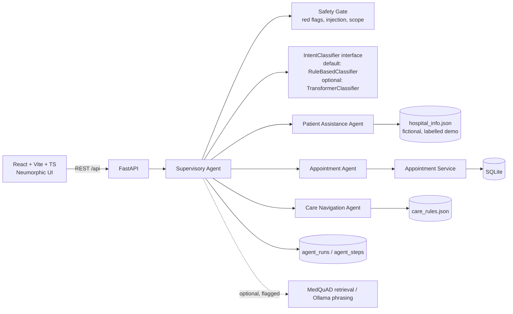

# Nova Health: Revised Implementation Plan (Partial Implementation)

> Status: **Approved** on 26 October 2026. This is the approved plan, saved word for word as the first project report.
> Nova Health was previously named "Hospivanta" in the project documents (`Context.md`, `Development.md`, `partial implementation.md`).

Two things changed most from the first draft. The required demo journey is now complete and tagged `v0.1-required-scope` by the end of Day 5, using only rules and plain code. GPU training, Ollama, health search and the front-desk page are now optional extras that start only after that, each behind an on/off setting.

---

## Problem Statement
Build a small, polished, working prototype of Nova Health's central idea: a Supervisory Agent that coordinates three specialist agents to help patients use hospital services. Constraints:
- 7 days.
- No cost.
- Runs locally on an i7-13620H laptop with 16 GB RAM and an RTX 4060.
- Fully aligned with `partial implementation.md`, which is the authoritative spec.

## Requirements
- **Five required modules:** Patient Dashboard, AI Hospital Assistant, Multi-Agent System, Preliminary Symptom Guidance, Appointment Management.
- **Required agents:** a Supervisory Agent plus the Patient Assistance, Appointment and Care Navigation agents.
- **Storage:** appointment requests are saved in SQLite with status Pending. The app never claims an appointment is confirmed.
- **Activity panel:** shows which agent handled each request, what it did and the result.
- **Symptom guidance:** fixed, cautious rules. It never names a diagnosis, and warning signs trigger urgent-care guidance (112 / 108, India).
- **Demo sequence:** the 6 steps in section 5 of the spec must work reliably.
- **Name:** Nova Health. The docs note it was earlier called "Hospivanta".
- **Data:** a fictional hospital with synthetic data only, all clearly labelled as demo data.
- **Each phase ends with:** the relevant tests run and their actual results recorded, a report in `docs/phase-reports/`, and a commit and push to `github.com/adityadarko372-lab/Agentic-Ai-Based-Hospital-Assistant`.
- **Optional enhancements** come only after the required journey works and is tested: DistilBERT fine-tuning, MiniLM fine-tuning or MedQuAD search, Ollama, voice input, and the front-desk review page.
- **No promised results:** no accuracy figure or search improvement is promised before it has been measured.

## Background
- **MedQuAD** (`abachaa/MedQuAD`): CC BY 4.0, NIH sources, 47,457 question-answer pairs.
  - The answers were removed from 3 MedlinePlus subsets, leaving about 16k usable answers. The download is under 100 MB.
  - Fit for optional search over general educational information, with attribution.
  - Not clinically validated, and some content is dated.
- **Ollama:** free, and runs locally on the GPU (Qwen2.5-7B Q4 at about 4.7 GB, or 3B). Optional, used only to reword answers.
- **Prerequisites the execution agent checks or installs:** Python 3.11, Node 20 LTS, Git, the NVIDIA driver. PyTorch with CUDA and Ollama are installed only in Phase 5.
- **Path warning:** the workspace path contains spaces, so every script must quote paths.

## Proposed Solution



**Stack**
- Frontend: React, Vite, TypeScript, React Router, a hand-built neumorphic CSS design system and Framer Motion.
- Backend: FastAPI with SQLModel on SQLite and Pydantic for validation.
- Tests: pytest, Vitest and Playwright.

**How the Supervisory Agent handles each message**
1. **Safety Gate first:** emergency warning signs, prompt-injection attempts and out-of-scope requests are caught here.
2. **Intent detection:** `IntentClassifier.predict(text)` returns the intent, a confidence score, the method used and the evidence. The default is a transparent rule classifier using weighted keywords and regular expressions, and it reports which words matched.
3. **Clarify if unsure:** if confidence is low, the assistant asks a clarifying question.
4. **Hand-off:** the message goes to exactly one specialist.
5. **Trace:** every step is saved and shown in the activity panel.

**Fallbacks and switches**
- Optional components load only when their setting is on and their files exist. Otherwise the app uses the rule-based or template version and records "fallback used" in the trace.
- Settings in `.env`: `INTENT_CLASSIFIER=rules|transformer`, `HEALTH_INFO_ENABLED`, `LLM_PHRASING_ENABLED`, `FRONT_DESK_ENABLED`.

**Login and security**
- Demo accounts use bcrypt-hashed passwords and signed session tokens.
- Patients can only see their own requests.
- The backend is bound to 127.0.0.1, and CORS allows only the Vite address.
- The docs state that demo login is not production-grade security.

## Directory Structure

```
/ (repo root)
  frontend/   src/{design-system, components, pages, services, hooks}, tests/
  backend/    app/{api, agents, services, db, knowledge, core}, tests/
  datasets/   README.md, LICENSES.md (Phase 5 only), raw/ (gitignored)
  model/      intent_classifier/, retriever/ (Phase 5 only), artifacts/ (gitignored)
  scripts/    setup.ps1, start.ps1, (Phase 5) download_datasets.py
  docs/       first report.md, architecture.md, setup.md, demo-script.md,
              implementation-status.md, screenshots/, phase-reports/
  README.md, .gitignore, .env.example
```

`datasets/` and `model/` are created only in Phase 5, and only if that work starts. That way no empty folders are added.

## Working Rules for Execution
- Inspect only what the current task needs, build it, run the relevant tests, fix critical failures, and record the result. No repeated broad audits.
- Never make up test results, confirmations, hospital facts or clinical validation. Reports record only commands that were actually run and their output.
- Every report labels each feature as Implemented, Simulated or Future work.
- If an optional piece breaks the required journey, switch it off and record why.

---

## Phase 1 (Day 1): Foundation and Visual Shell

**Dependencies:** none.

**Acceptance criteria**
- `scripts/start.ps1` starts both apps from a fresh clone.
- The frontend shows "Backend connected" from `/api/health`.
- The design system components render, are keyboard accessible, and the layout works on desktop and mobile.
- Tests pass, the Phase 1 report is written, and `main` is pushed to GitHub.

**If time is tight, defer:** page-transition animation polish.

**Task 1: Environment, repository, first report and project skeleton**
- Objective: tooling and a runnable skeleton.
- Guidance:
  - Save this plan as `docs/first report.md`.
  - Check or install Python 3.11, Node 20 and Git.
  - Create `.gitignore` (excluding `.env`, `*.db`, `node_modules`, `.venv`, model artifacts and raw data), `.env.example` and `README.md`.
  - Create the FastAPI app with `GET /api/health` and a pydantic-settings config that holds the feature settings. Create the Vite React TS app with an `/api` proxy.
  - Write `start.ps1` with all paths quoted.
  - Run `git init`, add the remote and push `main`. Work continues on `phase-N` branches that are merged back after each phase.
- Tests: pytest for `/api/health`, and a Vitest smoke test that the app renders.
- Demo: one command starts both apps, and the page shows backend status.

**Task 2: Neumorphic design system and app shell**
- Objective: a premium, accessible UI base.
- Guidance:
  - Design tokens (soft off-white base, teal/blue accents, restrained two-layer shadows, spacing scale, Inter font).
  - Components: Card, Button, Input, Select, Textarea, Badge (Pending / Confirmed / Emergency / Info), Toast, Skeleton loader, EmptyState, Modal, DemoDataBanner.
  - App shell: logo, navigation, mobile drawer, floating assistant button.
  - Accessibility: visible focus rings, text contrast of at least 4.5:1, and `prefers-reduced-motion` support.
- Tests: Vitest for component states and keyboard focus.
- Demo: placeholder pages can be navigated, and the layout responds to screen size.

---

## Phase 2 (Day 2): Persistence, Dashboard and Appointment Management

**Dependencies:** Phase 1.

**Acceptance criteria**
- A demo patient can log in.
- Submitting the appointment form saves a request that shows as Pending with a reference such as `NH-APT-0001` and survives a backend restart.
- Invalid input is rejected with clear messages, a double submission does not create a duplicate, and one patient can't read another patient's requests.
- The dashboard shows every element the spec lists (logo/navigation, welcome message, assistant button, services, symptom guidance option, booking option, recent activity), all connected to real data.
- Tests pass, the Phase 2 report is written, and the work is pushed.

**If time is tight, defer:** cancellation requests.

**Task 3: Database, demo data and minimal login**
- Objective: persistent storage and a simple identity.
- Guidance:
  - Tables: `users`, `departments`, `appointment_requests`, `agent_runs`, `agent_steps`, `activity_events`.
  - Load demo data on startup: fictional patients and departments from `backend/app/knowledge/hospital_info.json`, labelled demo.
  - Endpoints: `/api/auth/login` and `/api/auth/me`, plus a dependency that identifies the current user.
  - A login page and a session context in React.
- Tests: login success and failure, an unauthenticated request gets 401, and patients can't see each other's data.
- Demo: logging in as the demo patient leads to the dashboard.

**Task 4: Appointment Management (Module 5)**
- Objective: the spec's form, saved to the database, with an honest status.
- Guidance:
  - `AppointmentService` is shared later by the Appointment Agent.
  - `POST /api/appointments` validates name, department, preferred date (in the future, within 90 days) and reason (10–500 characters). It uses an idempotency key, sets the status to Pending, and adds a `submitted` activity event.
  - `GET /api/appointments/mine` lists the patient's requests.
  - UI: the form, a confirmation step, a "My Requests" list, and a fixed note: "Pending: not yet confirmed by the hospital".
- Tests: validation, persistence, duplicate prevention and ownership (pytest). Form validation (Vitest).
- Demo: submit a request, it shows as Pending, and it is still there after a refresh.

**Task 5: Patient Dashboard (Module 1)**
- Objective: the spec's dashboard, fully connected.
- Guidance:
  - Greeting.
  - Quick-access cards linking to the Assistant, Symptom Guidance and Book Appointment.
  - A services section loaded from `/api/hospital/departments`.
  - A summary of upcoming requests and a recent activity feed from `/api/activity/mine`.
  - Empty and loading states, and the demo-data banner.
- Tests: Vitest with mocked data and the empty state.
- Demo: the request from Task 4 appears in the activity feed.

---

## Phase 3 (Days 3–4): Supervisory Agent, Specialist Agents, Assistant and Activity Panel

**Dependencies:** Phase 2 (AppointmentService, login, activity tables).

**Acceptance criteria**
- The spec's four sample questions get relevant answers from `hospital_info.json`.
- "I want to book an appointment" is routed to the Appointment Agent, which collects the details over several messages, shows a confirmation card, saves the request through `AppointmentService` and shows it as Pending.
- The safety and edge cases behave correctly:
  - Messages describing symptoms are routed to the Care Navigation Agent.
  - Emergency phrases always produce the emergency card, whatever intent was detected.
  - Prompt-injection and out-of-scope requests are refused safely.
  - Unclear messages get a clarifying question.
- The activity panel shows, for every request: intent, confidence, method, evidence, agent selected, action, outcome and time taken.
- The table-based routing tests pass, and the results are recorded honestly in the report.
- The required journey works with every optional setting switched off.
- The Phase 3 report is written and the work is pushed.

**If time is tight, defer:** checking appointment status from chat. Cancellation through chat goes to Phase 5.

**Task 6: Classifier interface, Safety Gate and Supervisory Agent**
- Objective: routing that is clear, testable and traceable.
- Guidance:
  - `agents/base.py` defines `AgentContext` and `AgentResult`.
  - `intent/classifier.py` defines the `IntentClassifier` interface and `RuleBasedIntentClassifier`, which uses weighted patterns per intent and returns the matched evidence.
  - `intent/factory.py` picks the classifier from settings and falls back to rules.
  - `safety_gate.py` holds the warning-sign list (shared with the Care Navigation rules), injection patterns and scope checks.
  - `supervisor.py` runs: safety gate → classify → clarify if needed → hand off to one agent. Each step is written to the trace tables.
  - `POST /api/assistant/message` (with a conversation ID) and `GET /api/activity/runs`.
- Tests: a table of 40 or more messages mapped to the expected intent and agent; an emergency override test; an injection refusal test; a clarification test.
- Demo: an API call shows the routing and its saved trace.

**Task 7: The three specialist agents**
- Objective: the agents the spec requires, with honest answers.
- Guidance:
  - **Patient Assistance Agent:** matches the question to entries in `hospital_info.json` (departments, timings, what to bring, how to book, where services are). Answers are labelled with "Source: Nova Health demo directory". If nothing matches, it says the information isn't available and gives a safe next step.
  - **Appointment Agent:** a small state machine that collects the department, date (read with `dateparser`, Indian date order) and reason. The name comes from the logged-in profile. It asks for confirmation, then calls `AppointmentService` and returns the real reference and Pending status. It never uses the word "confirmed".
  - **Care Navigation Agent:** calls `care_engine.evaluate()`, built in this task and shared with Phase 4. It defines the warning signs and the four care levels (Urgent same-day / See a doctor soon / Routine / Self-care information), each with a suggested department. All wording avoids naming a diagnosis.
- Tests: tests for each agent, the "never confirmed" check, the "information not available" path, a check that no answer contains diagnosis wording, and a test for every warning sign.
- Demo: all three agents answer correctly through the API.

**Task 8: AI Assistant chat (Module 2) and Agent Activity panel**
- Objective: the visible agent coordination the spec asks for.
- Guidance:
  - Chat screen: message bubbles, typing indicator, the spec's four example questions as suggestion chips, and inline cards (appointment confirmation, emergency alert, guidance level, answer with its source).
  - A side panel showing a live timeline: Supervisor → Intent (confidence, method, evidence) → Agent → Action → Outcome.
  - An Activity History page listing past runs.
- Tests: Vitest for chat state. A Playwright test that books an appointment entirely through chat.
- Demo: steps 2, 3, 4 and 6 of the spec's sequence work end to end.

---

## Phase 4 (Day 5): Symptom Guidance Module, Required Demo Hardening and Milestone v0.1

**Dependencies:** Phase 3 (care engine, activity tracing).

**Acceptance criteria**
- The symptom form collects symptoms, duration and general information (age group, severity, pregnancy, long-term conditions).
- Warning signs show the emergency card immediately with 112 / 108, without further questions.
- Other inputs return one of the defined care levels with a suggested department, a "Request appointment" button that fills in the form, and a persistent disclaimer.
- The form and chat use the same engine and give the same result for the same input.
- A Playwright script runs all 6 steps of the spec's demo sequence and passes. Screenshots are saved to `docs/screenshots/`.
- `docs/implementation-status.md` lists Implemented, Simulated and Future work. `docs/demo-script.md` and `docs/setup.md` are written.
- The work is tagged `v0.1-required-scope` and pushed.

**If time is tight, defer:** animation polish (but not the accessibility basics).

**Task 9: Preliminary Symptom Guidance (Module 4)**
- Objective: the spec's questionnaire, safe and non-diagnostic.
- Guidance:
  - `POST /api/care-navigation/assess` calls `care_engine`.
  - The form uses a symptom checklist plus optional free text. Free text goes through the same warning-sign check.
  - The result card shows the care level, an explanation in plain words, a suggested department and the next-step buttons.
  - `care_rules.json` carries a version number and a note that the rules come from public guidance and are not clinically reviewed.
  - Each assessment is written to the activity trace as Care Navigation Agent work.
- Tests: tests for every warning sign and every care level, a check that the form and chat agree, and the form's error states.
- Demo: step 5 of the spec. Chest pain with sweating gives the emergency card. A mild cough for 3 days gives Routine guidance.

**Task 10: Required journey end-to-end testing, fixes and documentation**
- Objective: a reliable examination demo.
- Guidance:
  - Write a Playwright script for the 6-step sequence. Restart the backend and check the data is still there.
  - Fix any critical failures.
  - Accessibility check with axe, and the mobile layout check.
  - Screenshots and documentation.
- Tests: the full test suite, with actual counts recorded in the report.
- Demo: the full required demonstration, start to finish.

---

## Phase 5 (Days 6–7): Optional Enhancements, Final Regression and Delivery

**Dependencies:** v0.1 is tagged and the required journey is passing. Each enhancement sits behind its own setting.

**Acceptance criteria**
- Each enhancement that is attempted either works, with measured results and the v0.1 journey still passing, or is switched off with the reason documented.
- The 6-step Playwright journey still passes with all settings on and with all settings off.
- The final report and an updated `implementation-status.md` are written. The work is tagged `v0.2` and pushed.
- Day 7 afternoon is kept for the final regression run and a demo rehearsal. Any unfinished enhancement is dropped rather than merged half-done.

**Enhancements in priority order (stop when time runs out)**

**Task 11 (optional): Front-desk review page**
- Objective: a human sign-off before a request is confirmed.
- Guidance:
  - A demo `front_desk` role and a page listing Pending requests.
  - Approve or reject with a note. A request can only change status once, with no duplicate approvals.
  - Each decision creates an activity event and a patient notification.
  - The status becomes Confirmed only after this staff action.
- Tests: role enforcement, the allowed status changes, the event being recorded.
- Demo: staff confirm `NH-APT-0001`, and the patient sees the change.

**Task 12 (optional): General health information from MedQuAD**
- Objective: answers to general health questions, with the source cited.
- Guidance:
  - `download_datasets.py` downloads MedQuAD. Parse it into JSONL, drop entries with no answer and remove duplicates.
  - Build a search index with the base `all-MiniLM-L6-v2` model, stored as a plain NumPy array.
  - Add a health-information tool used by the Patient Assistance Agent (or a separate optional agent), with an NIH citation and the "general educational information" label.
  - If the index is missing, the assistant reports "unavailable".
  - Write the dataset README and licence notes.
- Tests: the parser is correct, sources are present, and the app falls back when the index is missing.
- Demo: a general health question returns a cited answer.

**Task 13 (optional): Transformer intent classifier (GPU)**
- Objective: compare a trained model against the rules.
- Guidance:
  - Build a set of intent examples from templates plus CLINC150 out-of-scope examples. The CLINC150 licence is checked first.
  - Fine-tune DistilBERT on the RTX 4060 with mixed precision (fp16).
  - Evaluate the trained model and the rule classifier on the same held-out test set.
  - `TransformerIntentClassifier` implements the same interface.
  - It becomes the default only if it measurably beats the rules on that test set. The Safety Gate always runs first.
- Tests: the comparison is recorded with real numbers, and the app falls back when the model is missing.
- Demo: the activity panel shows `method: transformer` and its confidence.

**Task 14 (optional): MiniLM fine-tuning, Ollama phrasing, voice input**
- Objective: final quality improvements.
- Guidance:
  - **MiniLM:** fine-tune on held-out MedQuAD questions and report search quality (Recall@k and MRR) before and after. Adopt it only if it is better.
  - **Ollama:** used only to reword answers from the information the agents already found. Timeout of 8 seconds or less, then templates are used.
  - **Voice input:** the browser's Web Speech API, shown only where the browser supports it.
- Tests: a fallback test for each, and the measured numbers recorded.
- Demo: the same journey, with richer wording and voice input.

**Task 15: Final regression, polish and delivery**
- Objective: the project is ready to submit.
- Guidance: run the full suite in both setting modes, update the screenshots, write `architecture.md` and the final phase report, tag and push, and rehearse with `demo-script.md`.
- Demo: a fresh clone runs with `setup.ps1` followed by `start.ps1`.

---

## Reports and GitHub Workflow
- Reports go in `docs/phase-reports/phase-N-<name>.md`. Each covers:
  - what was intended and what was actually built
  - how it works, including data and agent flow
  - key files
  - commands to run it
  - tests run, with their real output
  - known limitations
  - Implemented / Simulated / Future work
  - the next steps
- Each phase is committed on its `phase-N` branch and merged into `main` once the tests pass. Tags: `v0.1-required-scope`, then `v0.2`.
- No secrets or real personal data are ever committed. Model files and raw datasets are gitignored and can be rebuilt with the scripts.
- The first push may open a browser window for GitHub sign-in through Git Credential Manager. That is the only step that needs you.

## Zero-Cost Fallback Chain
1. **Intent:** the transformer classifier, if it's on and its files exist. Otherwise the rule classifier. Otherwise a clarifying question.
2. **Answers:** Ollama rewording, if it's on and responds within the timeout. Otherwise fixed templates.
3. **Health information:** the MedQuAD index, if it's on and present. Otherwise "unavailable, please consult a doctor or the hospital helpdesk".
4. **The required journey** depends on none of the optional parts.

## Defaults for Open Details
- Fictional hospital: "Nova Health Multi-Speciality Hospital", Pune.
- Demo account: `patient@novahealth.demo`, plus `frontdesk@novahealth.demo` if Task 11 is built.
- Expected disk use: under 3 GB for the required scope and about 15 GB if every optional task runs.
